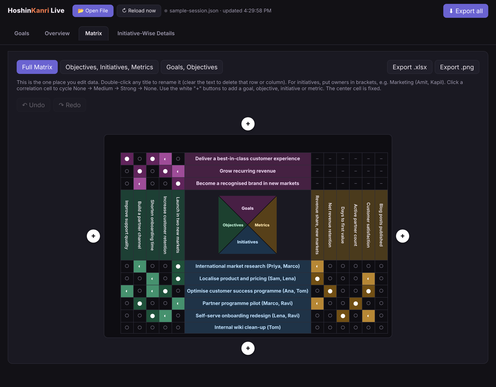
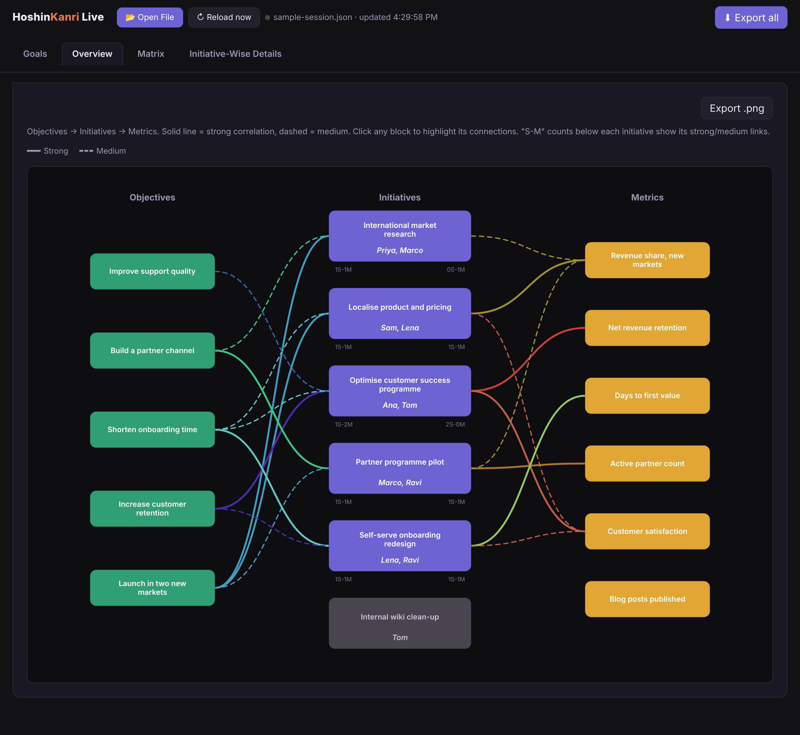
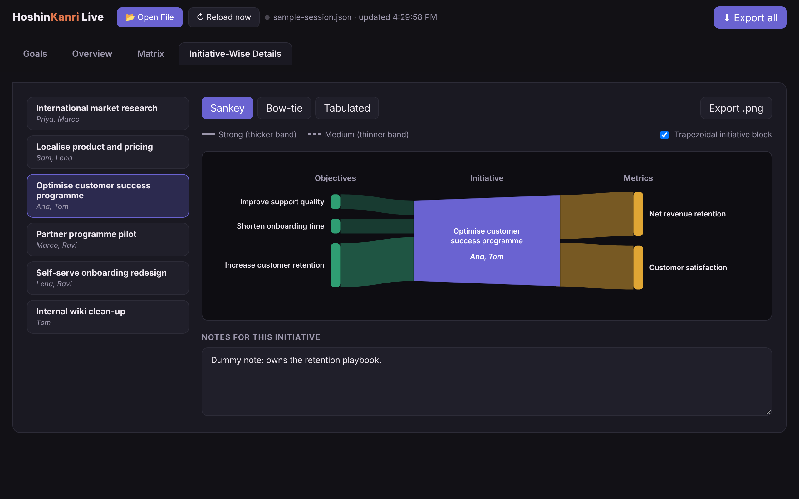

# Hoshin Kanri Live

> Strategy teams can build and revise a Hoshin Kanri X-matrix live in a meeting, and see how goals, objectives, initiatives and metrics connect, without redrawing slides or reworking a spreadsheet.

[](LICENSE)
[](https://dvynsh3.github.io/Hoshin-Kanri/)
[](../../releases)

**Try it:** [live demo](https://dvynsh3.github.io/Hoshin-Kanri/)  ·  **Status:** active  ·  **Platform:** browser (Chrome or Edge recommended), works fully offline

<!-- SCREENSHOT: hero -->


## Why this exists
- **Who:** people facilitating a Hoshin Kanri session with a large group of leaders, for example a review where teams present their initiatives and the room then aligns them to goals and metrics.
- **Before:** the exercise was done on paper or in an Excel sheet, and no detailed template existed, so I built the spreadsheet myself. It was tedious, and just explaining the template to a large group of leaders was the first hurdle.
- **Now:** type into the matrix on the page and every view redraws at once, so gaps (an initiative with no objective, a metric nobody moves) are visible while the room is still talking. It is far more intuitive to explain and use.

## What it does
**Build the matrix**
- Edit goals, objectives, initiatives and metrics directly in the X-matrix. Rename in place, delete by blanking a title, add with the **+** buttons, cycle each link between none, medium and strong.
- Undo and redo any change (last 60 steps).

**See alignment**
- Draw objectives, initiatives and metrics as a connected flow. Solid lines are strong links, dashed are medium, and initiatives with no links turn grey.
- Click any block to dim everything except its connections.
- Show goals as cards with their linked objectives, and each initiative as a Sankey, Bow-tie or Tabulated view with a notes box.

**Keep and share the result**
- Export the matrix as a three-sheet Excel workbook, any view as a PNG, or everything at once as one zip.
- Reopen a saved zip or JSON file to restore the exact session, including notes.

<!-- SCREENSHOT: key flow -->



## Quick start
1. Open the [live demo](https://dvynsh3.github.io/Hoshin-Kanri/), or download `index.html` and double-click it. The file is about 2 MB and needs no connection.
2. Click **Open File** and choose [`examples/sample-session.json`](examples/sample-session.json) to load a dummy session. To start blank, skip this step.
3. Go to **Matrix** and stay on **Full Matrix**. Double-click a title to rename it, click a cell to change a link, use the white **+** buttons to add rows or columns.
4. Open **Overview** and click an initiative.

Expected result: the matrix and the other tabs update as you edit, and clicking an initiative dims everything not connected to it.

## Decisions and trade-offs
| Decision | Over | Because |
|---|---|---|
| One self-contained HTML file | A hosted app or install | It had to be copied to an office laptop and opened without install. |
| Edit on the page, Excel as one-time import | Live-polling the Excel file | Polling would overwrite edits made on the page (changed in v0.12.0). |
| The Full Matrix is the only editable surface | Editing on every tab | One place to input keeps every other view in sync. |
| Draw PNG exports on a canvas | Screenshot library for every view | The screenshot library produced black or broken Sankey, Bow-tie and Tabulated images (fixed in v1.0.0 and v1.1.0). |
| Plain file picker for Open File | Browser file-handle API | The file-handle approach did not behave reliably on the hosted page (changed in v0.15.0). |

**What I left out on purpose**
- Links between organisation or CEO goals and metrics. In my view they make the exercise more confusing and are not directly relevant to it. Dropping them streamlined the flow and made the tool quicker to understand, and the loss is minimal.

## Known limits
- Single user, on one device. There is no sharing or multi-user editing, and data lives in the browser tab only. It is not saved automatically, so refreshing the page loses it. Use **Export all** to save a session.
- Excel import reads the template's fixed layout: up to 15 objectives, 15 metrics, 15 initiatives and 5 goals. Notes are not carried by Excel import.
- Sankey labels longer than 28 characters are shortened with an ellipsis.
- The file is about 2 MB because four libraries (SheetJS, ExcelJS, JSZip and html2canvas) are built into it. Earlier builds loaded them from the internet; from v1.3.0 nothing is loaded from outside.
- Chrome or Edge recommended. The app opens on the Goals tab.
- Excel limits sheet names to 31 characters, so the second exported sheet is named "Objective, Initiatives, Metrics".

## Privacy and data
- Everything you type stays in your browser. The tool has no backend, no analytics and makes no network calls of its own.
- Nothing is requested from the internet. The libraries are built into the file, so the page works with no connection. (Builds before v1.3.0 loaded them from `cdnjs.cloudflare.com`.)
- Exports are created on your device and saved by your browser. Sample data in this repo is fictional.

## Evidence
A test run was conducted with a few people. No usage numbers collected yet.

## Version history
Latest: **v1.3.0** (2026-11-26). Full detail in [CHANGELOG.md](CHANGELOG.md) and [Releases](../../releases).

| Version | Date | What changed for the user |
|---|---|---|
| v0.1.0 | 2026-09-23 | First build: shows an Excel template as four views and refreshes as the file changes. |
| v0.4.0 | 2026-09-24 | Colour-coded objectives, click-to-highlight in Overview, new Matrix tab. |
| v0.12.0 | 2026-09-28 | Data entry moves onto the page: rename, delete, add, cycle links, undo and redo. |
| v0.14.0 | 2026-09-29 | Export all, notes per initiative, and restoring a saved session. |
| v1.0.0 | 2026-09-30 | Sankey and Bow-tie PNG exports fixed (they were solid black). |
| v1.2.0 | 2026-10-16 | Initiative owners editable in the matrix, e.g. `Marketing (Amit, Kapil)`. |
| v1.3.0 | 2026-11-26 | Fully offline: the libraries are built into the file, so nothing is loaded from the internet. |

Versions v0.1.0 to v1.2.0 are archived builds restored from local backups, uploaded to GitHub together in November 2026; the source at each tag is the repository snapshot at upload, not the original code for that version. I built them offline, so their dates are the saved-file dates of each build, not release dates, and the commit history is not a record of the build. v1.3.0 was built after that upload, and every future build will have the libraries built in.

## Feedback
Open an [issue](../../issues). Useful to include: browser and version, what you clicked, what you expected, and a screenshot using dummy data. Please do not attach files with confidential strategy content.

## How this was built
I owned the problem, the scope, the trade-offs and the testing: I specified each view and change, tried every build against my own template and reported what was wrong. Claude (Anthropic) wrote most of the implementation from those instructions.

## Credits
- Example data is fictional. Its theme is loosely based on the generic international-expansion example in [Asana's Hoshin Kanri guide](https://asana.com/resources/hoshin-kanri).
- Libraries built into `index.html` since v1.3.0: SheetJS 0.18.5, ExcelJS 4.4.0, JSZip 3.10.1 and html2canvas 1.4.1, each with its own licence header kept in the file. See each project for its licence.

## Licence
[MIT](LICENSE). Copyright (c) 2026 dvynsh3. The embedded libraries keep their own licences.

<details>
<summary>Reference: tabs, editing, import and export, repo layout</summary>

| Tab | What it shows |
|---|---|
| **Goals** | Goals as cards (3 per row) with linked objectives and Strong/Medium pills |
| **Overview** | Objectives, Initiatives, Metrics flow. Solid line = strong, dashed = medium. Click any block to highlight its connections |
| **Matrix** | Three toggles: Full Matrix (the X-matrix, the only editable surface), Objectives/Initiatives/Metrics, Goals/Objectives |
| **Initiative-Wise Details** | Per-initiative Sankey, Bow-tie and Tabulated views, plus a notes box that is included in exports |

**Editing (Matrix, Full Matrix)**
- **Rename:** double-click any title. For initiatives, owners go in brackets, e.g. `Team1 (Owner1, Owner2)`.
- **Delete:** rename to blank (removes the row or column and its links).
- **Links:** click a correlation cell to cycle None, Medium (2), Strong (5), None.
- **Add:** **+** buttons at the left (objective), right (metric), top (goal) and bottom (initiative).
- **Undo / Redo:** buttons above the matrix.

**Import and export**
- **Open File** accepts `.xlsx` / `.xlsm` (one-time import from the Hoshin template workbook), `.zip` (an **Export all** bundle) and `.json` (a raw `hoshin-state.json`).
- **Export .xlsx** (Matrix tab): three sheets (Full Matrix, Objective/Initiatives/Metrics, Goals/Objectives).
- **Export .png**: current view only, black background, up to 3x resolution.
- **Export all** (top right): one zip with every PNG, the `.xlsx` and `hoshin-state.json`.

**Repo layout**
```
index.html        The whole tool, libraries included (HTML + CSS + JS in one file), currently v1.3.0
examples/         sample-session.json, a dummy session to load with Open File
templates/        FULL Hoshin Kanri.xlsx is the template Open File imports;
                  Hoshin Kanri.xlsx is its first version, kept for archive only
exports/          Sample output generated from the template's placeholder text
docs/screenshots/ Images used in this README (dummy data)
CHANGELOG.md      Release history
LICENSE
```
</details>